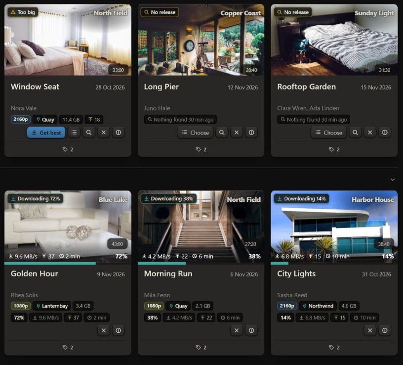
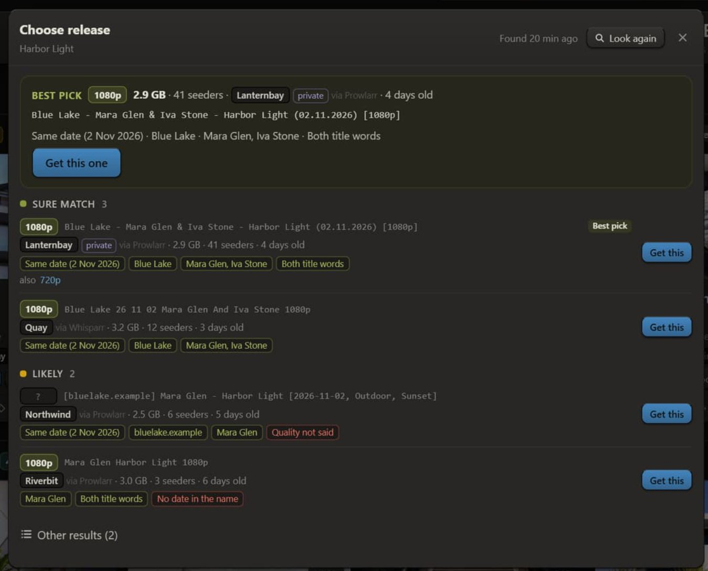

# SceneBackfill 界面改版备忘录

> 2026-11-20　状态：**§9 已实施**（令牌层、pill tab、统计卡、工具条、网格/列表两套、详情与下载两个弹窗、已完成按天分组）。索引器/分辨率下拉已做：只在「有结果」页出现，按场景的最佳候选取候选值，选项为 0 时不渲染。
> 参考实现已解包在 `E:\Temp\dtplug\src\DownloadsToolkit`（v0.16.0，4314 行 py + 3872 行 js，CSS 内嵌在 js 里）。

## 0. 一句话结论

Downloads Toolkit 的界面是**同一套 Flexoki 令牌 + 彩色语义徽章 + 图标按钮 + 一行式工具条**，列表与网格只是这套令牌的两种排布。要抄的是这套「语言」，不是某个页面。

| 照搬 | 改造后采用 | 不抄 |
|---|---|---|
| 状态/徽章体系（颜色语义、三态理由 chip） | 统计卡（数字 + 颜色点） | 六列固定列宽的极端压缩 |
| 分段控件（网格/列表）、图标按钮组 | 工具条（搜索 + 筛选图标 + 下拉） | Whisparr 的 matched 标记与片长偏好 |
| 分组折叠 header（图标 + 名字 + 计数 pill） | Choose release 的三组 + BEST PICK 条 | 它的 best pick 权重（我们没有片长、没有 its own match 信号） |
| 顶栏 pill tab + 未读计数 | History → 我们的「已完成」 | |

---

## 1. 顶栏与 tab


- 左：图标 + `Downloads Toolkit`（22px/700）+ 一行灰字说明（12px，`--sx-tx2`）。标题与说明同一行，说明不换行。
- 右：一个**下沉的胶囊容器**（`--sx-bg2` 底 + 内阴影 `inset 0 2px 5px`），里面 4 个 tab：
  `☆ Discover` / `⤓ Downloads 12` / `🕘 History` / `🔗 Sources`。
- 选中态 = 容器内一块圆角 8px 的填充块，底色是 `color-mix(该 tab 的主题色 24%, --sx-ui)`、边框同色 55%，文字提亮到 `--sx-hi`；tab 图标在未选中时只有 75% 不透明度。
- 每个 tab 有自己的语义色：Discover=绿(gr)、Downloads=蓝(bl)、History=紫(pu)、Sources=青(cy)；`--acc` 随 tab 切换，页面里所有主按钮跟着变色。
- 计数是 tab 文字后的独立小 pill（11px/700，底色 `--sx-bg` 下沉），待处理数用黄色文字。
- 页面用 `?tab=<key>` 记住位置，切换 tab 写 URL。

```css
.tabs { display:flex; gap:4px; margin-left:auto; padding:4px; border-radius:11px;
        background:var(--sx-bg2); border:1px solid var(--sx-deep);
        border-bottom-color:var(--sx-ui2); box-shadow:var(--sx-well); }
.tab  { padding:6px 13px; border-radius:8px; border:1px solid transparent; color:var(--sx-tx1b); }
.tab.on { color:var(--sx-hi); background:color-mix(in srgb,var(--tc) 24%,var(--sx-ui));
          border-color:color-mix(in srgb,var(--tc) 55%,transparent); }
```

「底 + 实心」这套 stashDiscover 已经在用，统一即可。

---

## 2. 统计卡（数字 + 颜色点）


- 一行 5 张，等高，圆角 12px，`linear-gradient(180deg, --sx-raise, --sx-ui)` 顶亮底暗，上边框 `--sx-edge` 提亮。
- 卡内：**大数字 22px/700 等宽数字**（`font-variant-numeric: tabular-nums`），下面一行 12px：`色块(8px 圆角 3px) + 标签`。
- 颜色点就是这组状态的主题色：待处理黄、下载中青、等待蓝、已入库绿；数字为 0 时数字转灰（`--sx-tx3`）。
- 最后一张是**宽卡**：`12.7 GB` + `to go · 1.6 TB free`，没有色点，不可点。
- 这排卡**同时是筛选器**：点一下只看该组，再点回到全部（`data-zero` 的卡灰掉但仍可点）。

```css
.tiles { display:grid; grid-template-columns:repeat(4,minmax(0,1fr)); gap:8px; }
.tile  { padding:9px 12px; border-radius:12px; display:flex; flex-direction:column; gap:3px;
         background:linear-gradient(180deg,var(--sx-raise) 0,var(--sx-ui) 64px);
         border:1px solid var(--sx-line); border-top-color:var(--sx-edge); }
.tile b { font-size:22px; font-weight:700; line-height:1.1; color:var(--sx-hi); }
.tile span::before { content:""; width:8px; height:8px; border-radius:3px; background:var(--c); }
.tile.on { background:color-mix(in srgb,var(--c) 18%,var(--sx-ui));
           border-color:color-mix(in srgb,var(--c) 60%,transparent); }
```

History 页是同一组件的 6 列版（`grid-template-columns:repeat(6,minmax(0,1fr))`，数字降到 18px）。

---

## 3. 工具条


从左到右，全部等高（30px），同一行不换行（窄屏才折）：

1. **搜索框**：占满剩余宽度但 `max-width:420px`，左侧放一个 14px 放大镜（绝对定位），输入框 `padding-left:30px`。
2. **两个图标按钮**（漏斗 / 标签），做成 `btn-group` 拼接，按下有 `active` 态 —— 打开后是浮层，不是新页面。
3. **下拉**：`By what to do`，原生 `<select>`，左侧文字右侧上下箭头。
4. **网格 / 列表切换**：一个下沉容器里两个图标按钮，选中那个是实心方块（截图里红框处）。这是**分段控件**，不是两个独立按钮。
5. **`✓ Select`**：进入多选模式，之后每张卡左上角出现勾选圆点。
6. **`🔍 Find releases (4)`**：本页主操作，括号里是待处理数量。
7. **刷新**：右端一个方形图标按钮。

```css
.seg { display:inline-flex; gap:3px; padding:3px; border-radius:10px;
       background:var(--sx-bg2); border:1px solid var(--sx-deep);
       border-bottom-color:var(--sx-ui2); box-shadow:var(--sx-well); }
.segb { padding:3px 10px; border-radius:7px; border:1px solid transparent; }
.segb.on { color:var(--sx-hi); background:color-mix(in srgb,var(--acc) 22%,var(--sx-ui));
           border-color:color-mix(in srgb,var(--acc) 50%,transparent); }
```

分段控件里也可以放文字（History 的 `All 8 / In your library 4 / Cancelled 2 / Failed 2`，数字用 `b` 加粗灰色）。

---

## 4. 分组与行（列表模式）


**分组 header**：一行，左侧组图标（组色）+ 组名 15px/600 + 计数 pill（组色 20% 底、45% 边、圆角 6px），右侧一个折叠箭头（收起时旋转 -90°）；「Needs you」这组额外在右端挂一个批量操作 `✕ Remove 2 with no release`。

```css
.group { padding:0 0 14px; border-top:1px solid var(--sx-ui2); }
.gh    { display:flex; align-items:center; gap:10px; padding:14px 4px 12px; }
.gn    { font-size:12px; font-weight:700; padding:0 7px; border-radius:6px;
         background:color-mix(in srgb,var(--c) 20%,var(--sx-bg2));
         border:1px solid color-mix(in srgb,var(--c) 45%,transparent); }
```

**行**是固定六列网格，行高约 56px：

```css
.row { display:grid; grid-template-columns:auto 96px minmax(0,1fr) 150px 290px 190px;
       align-items:center; gap:10px; padding:5px 8px 5px 5px; border-radius:10px;
       background:var(--sx-ui); border:1px solid var(--sx-line); border-top-color:var(--sx-edge); }
```

| 列 | 内容 |
|---|---|
| 1 | 多选勾选（仅 Select 模式） |
| 2 | 封面 96px 16:9，圆角 5px；下载中时封面下方压 4px 进度条 |
| 3 | 标题 14px（超长省略）+ 一行灰字 `厂牌 · 站 · 日期` 12px |
| 4 | 状态：图标 + 文字（`☰ Choose` / `⤓ Downloading 72%` / `🔍 No release`），下面可带进度条与 `9.6 MB/s · ⛁37 · ◷2 min` |
| 5 | 徽章串：`1080p` `🏷 Lanternbay` `2.9 GB` `⛁41`，单行不换行，溢出裁掉 |
| 6 | 操作：主按钮 `⤓ Get best`（蓝，实心）+ 3 个图标按钮（列表/搜索/关闭/信息） |

- 中等宽度（768–1240）**先砍掉徽章列**（`display:none`），标题保留；手机再砍到 4 列，操作按钮竖排。
- 「卡在这」的行整体 `opacity:.62`，hover 恢复 1。
- 状态色直接用行底色之外的徽章表达，**不再用左侧色带**（作者注释：用户不喜欢左边那条色带，0.14.0 去掉）。

**图标按钮**统一：

```css
.btn.icb { padding:4px 6px; }         /* 22×22，图标 14px */
```

---

## 5. 卡片（网格模式）




- 封面 16:9，上面压四层信息：
  - 左上：状态徽章（`⊘ Too big` / `🔍 No release` / `⤓ Downloading 72%`），底色是状态色 20% + 状态色 45% 边框，文字提亮；
  - 右上：厂牌名（半透明黑底小 pill）；
  - 右下：片长 `34:51`；
  - 下载中：封面底部一条通栏进度条 + 右下角百分比。
- 封面下方：标题（15px/600）与日期（12px 灰）分列两端 → 演员名一行灰字 → 徽章行 → 操作行（`⤓ Get` 蓝实心 + `⊘ Skip` + 外链图标）→ 底部 `⛁ 2` 小灰字。
- 下载中的卡把 `72% / 9.6 MB/s / ⛁37 / ◷2 min` 拆成 4 个小 pill 排一行。
- 列宽：`repeat(auto-fill, minmax(min(var(--cw,220px),100%),1fr))`，`--cw` 由缩放档位 `[240,320,420,560]` 提供。
- 宽度 ≤768 时封面上的厂牌 pill 隐藏，动作按钮改为纯图标。

**状态与徽章的全部语义**（图片来源截图逐一核对）：

| 语义 | 图标 | 颜色 | 用法 |
|---|---|---|---|
| Needs you | ⚠ | 黄 ye | 需要人决定（要选版本/超上限/没空间/失败） |
| Downloading | ⤓ | 青 cy | 下载中，带百分比与进度条 |
| Importing | ⤓ | 青 | 已下完，正在搬入 |
| Waiting | ◷ | 蓝 bl | 排队/等下一轮 |
| Searching | 🔍 | 蓝 | 正在搜 |
| In your library | ✓ | 绿 gr | 已入库 |
| Failed / Cancelled | ✕ | 红 re | 放弃或取消 |
| No release | 🔍 | 灰 + 黄字 | 搜过没有 |
| New | — | 紫 pu | 新进列表 |
| 1080p / 2160p | — | 中性 | 分辨率，未知时不画 |
| 站点 | 🔌 | 中性 | 索引器名，`private` 单独一个小字 |
| 做种 | ⛁ | 中性，0 变红 | 做种数 |
| 体积 | — | 中性 | `2.9 GB` |

徽章/小 pill 统一形态：`font-size:11-12px; line-height:18px; padding:0 7px; border-radius:6px;` 底色 `color-mix(状态色 20%, 页面底)`、边框同色 45%、文字用 `--sx-hi`。**没有纯文字按钮**，全部带 16px 内联 SVG 图标（`stroke-width:1.6`，`currentColor`）。

---

## 6. History（对应我们的「已完成」）


1. 顶部 6 张统计卡：`20 Asked` / `13 Taken` / `4 In library` / `4 Failed or given up` / `50 min Get to library` / `10.3 GB Moved`（蓝/青/绿/红/紫/粉）。
2. 一行胶囊：`Last 30 days` `All` `Indexers and watch lists`（时间段）。
3. 一行说明文字（灰，12px）：说明排序与「库里的场景不会从这里删」。
4. 分段控件筛选：`All 8 / In your library 4 / Cancelled 2 / Failed 2` + 搜索框。
5. 按日期分组：`TODAY` / `YESTERDAY` / `LAST 7 DAYS`，大写、12px、`letter-spacing:.04em`、灰色。
6. 行：封面（取消/失败时 `opacity:.55`）→ 标题 + `1080p` `🏷 站点` `厂牌 · 站点 · 2.2 GB · 3 h ago · in 35 min` → 换行一整条**原始发布名**（等宽、灰色、可省略）→ 右端状态 pill（绿 `✓ In your library` / 灰 `Cancelled`）。

值得抄的点：**一行记录里同时留住「原始发布名」**——事后核对是哪条资源时，标题是不够的。

---

## 7. Choose release（对应我们的详情弹窗）



- 头部：`Choose release` + 场景名；右端 `Found 20 min ago` + `🔍 Look again` + `✕`。
- 顶部一块**高亮区**（主题色 8% 底、45% 边框、圆角 12px）：`BEST PICK` 小标签（绿、大写）+ 一行徽章 `1080p` `2.9 GB` `41 seeders` `🏷 Lanternbay` `private` `via Prowlarr` `4 days old` → 等宽发布名 → 一行理由 chip → `⤓ Get this one` 大按钮。
- 之后按组：`● SURE MATCH 3` / `● LIKELY 2` / `⏷ Other results (2)`。组头是色点 + 名字 + 数字，不是折叠块（只有 Other 折叠）。
- 每条：`1080p` 徽章 + 发布名（中段）+ 右端 `Best pick` 黄色小标签；下一行 `Lanternbay | private | via Prowlarr | 2.9 GB · 41 seeders · 4 days old`；再下一行**理由 chips**，最后一个 chip 是缺失项的红字（`Quality not said` / `No date in the name`）；右端 `Get this`。
- 理由 chip 三态：`ok=true` 中性/绿边，`ok=false` 红字红边，`ok=null` 灰（既不是支持也不是反对）。

这套「分组 + 每组一条最像的 + 每条都写清凭什么」正是我们现在详情弹窗最缺的：我们只给了「通过/待确认/淘汰」和卡在哪条规则。

---

## 8. 视觉令牌（值得整体搬）

```js
FLEX = { bg:"#100F0F", bg2:"#1C1B1A", ui:"#282726", ui2:"#343331", ui3:"#403E3C",
         raise:"#2D2C2A", edge:"#48463F", line:"#0D0C0C", line2:"#0B0A0A", deep:"#000000",
         tx3:"#575653", tx2:"#878580", tx1b:"#B7B5AC", tx:"#CECDC3", hi:"#E6E4D9", on:"#100F0F" };
HUES = { re:["#D14D41","#AF3029","#E8705F"], or:["#DA702C","#BC5215","#EC8B49"],
         ye:["#D0A215","#AD8301","#DFB431"], gr:["#879A39","#66800B","#A9BA5A"],
         cy:["#3AA99F","#24837B","#5ABDAC"], bl:["#4385BE","#205EA6","#66A0C8"],
         pu:["#8B7EC8","#5E409D","#A699D0"], ma:["#CE5D97","#A02F6F","#E47DA8"] };
```

关键在**派生**而不是硬编码：`suiteTheme()` 读页面实际的 `body` 背景、`surface`、文字色，再推出 `ui2/ui3/raise/edge/line/deep/slab/hi/tx1b`，并保证对比度：

- 文字与背景对比 < 4.5 → 换成 `#F5F8FA` / `#1C2127`；
- 卡片与页面几乎同色（对比 < 1.04）或差太多（> 3）→ 用 `mix(bg, tx, 7%)` 造一个台阶；
- 浅色主题下自动走另一套混合方向，阴影强度由 `--sx-k` 缩放。

我们现在的做法是 `pageIsDark()` 测一次亮度、挂 `is-dark/is-light`、两套常量手写。搬到 SceneBackfill 后能顺手解决三件事：浅色主题下 option 白底白字、`--bs-*` 变量不存在、以及未来要换主题。

### 8.1 实际采用的做法（比 suiteTheme 省一步）

没有搬 `suiteTheme()` 的运行时采样，而是**把「中性面」全部换成半透明叠层**：

- 卡片/面板 `rgba(255,255,255,.05)`（亮色 `rgba(255,255,255,.68)`），边框 `rgba(255,255,255,.13)`，下沉槽 `rgba(0,0,0,.26)`——底色是 Stash 的就跟着变，不用采样也不会糊出一块异色矩形（Flexoki 的 `#100F0F` 在 Stash 的 `#202b33` 上会是一个明显的方块）；
- 语义色（红橙黄绿青蓝紫）用 Flexoki 双值，靠 `.is-dark` / `.is-light` 切；
- 组件只写 `var(--sf-*)` 和 `.is-h-<hue>`（该工具类只给 `--c` / `--cr` 两个变量），样式表里不再出现字面色值。

对照：stashDiscover 走的是「尽量复用 Stash 原生类」，它没有令牌也没有运行时测色，弹窗是写死的深色（`--ssd-modal-bg:#2b2b2b`）。三种做法里，半透明令牌最适合「自带卡片墙 + 要跟主题」的场景。

---

## 9. 映射到 SceneBackfill（建议，未实施）

### 9.1 顶栏 tab

现在 6 个：待处理 / 有结果 / 下载中 / 已完成 / 已忽略 / 设置。
建议改成 pill 容器（样式照抄），数量词去掉英文 `(0.1.0)` 版本号移到 tooltip：

```
待处理 12 | 有结果 6 | 下载中 1 | 已完成 | 已忽略 | 设置
```

### 9.2 统计卡（5 张）

| 卡 | 数字 | 色 | 点击 |
|---|---|---|---|
| 待处理 | pending 数 | 黄 | 切到待处理 |
| 有结果 | matched 数 | 绿 | 切到有结果 |
| 下载中 | 未入库任务数 | 青 | 切到下载中 |
| 待入库 | ready 数 | 蓝 | 切到下载中并筛选 ready |
| 宽卡 | `占用 13.1 GB / 上限 200 GB` + `今日已推 3/10` | — | 打开设置 |

### 9.3 工具条

搜索（番号 / 标题 / 演员）· 索引器 / 分辨率下拉 · 网格/列表分段 · 多选 · 刷新。整组居中，不铺满；所有控件等高 30px。

- 两个下拉只作用于「有结果」页，且筛的是**场景**（看该场景最佳候选的来源站与分辨率）。
- 选项从当前这一屏真实出现的值里取；一个都没有就不渲染。
- 桌面端不出现「更多」，窄屏才有，而且是**唯一**的一枚：下拉、视图、多选、刷新，加上本 tab 的批量动作（全部下载 / 全部暂停 / 移除缺失、清空记录、全部还原）和自动开关，全收在这里。正文里的原件窄屏隐藏，动作只在一个地方出现。
- 列表条（下载中）左连接状态、右批量按钮，一行；窄屏只留左边那句话。

### 9.4 行内六列

`勾选 | 封面 96px | 标题+演员·日期 | 状态+进度 | 徽章（-C/-U/UC、免费、1080p、体积、做种） | 按钮（推送最佳 / 详情 / 忽略）`。

### 9.5 状态映射

| 现状 | 新徽章 | 图标 | 色 |
|---|---|---|---|
| captured | 待搜索 | ◷ | 灰 |
| searching | 搜索中 | 🔍 | 蓝 |
| matched | 有结果 | ✓? → 用 ⤓ | 绿 |
| low_confidence | 待确认 | ⚠ | 黄 |
| no_result | 无结果 | 🔍 | 灰 |
| pushed/downloading | 下载中 72% | ⤓ | 青 |
| downloaded | 待入库 | ⤓ | 青 |
| importing | 入库中 | ⤓ | 青 |
| imported | 已入库 | ✓ | 绿 |
| missing | 任务已丢失 | ✕ | 红 |
| ignored | 已忽略 | ⊘ | 灰 |

---

## 10. 它如何判断「最佳」（源码实测）

入口 `match_release(title, facts)` → `grade()` → `fit_key()` → `auto_ok()` → `best_pick()`。

### 10.1 信号与分值

| 信号 | 判定 | 分值 |
|---|---|---|
| 日期 | 标题里的日期 vs 场景日期：`exact +40` / `near(±2 天) +20` / 同年 `+5` / 另一个日期 `-40` / 另一年 `-20` | 主导项 |
| 站点 | 场景的 studio / host 名完整出现在标题里 `+20`；只出现网络（net）`+10` | |
| 演员 | `15 × 命中人数/总人数`，全部命中额外 `+5` | |
| 标题词 | 场景标题词在发布名里的覆盖率 `t`：`+30t` | 括号里的标签词权重只有 **0.15**（`TAG_W`），不算正片标题词 |
| 番号 | 同番号 `+40`；形似另一番号（字母相同、数字差 ≤1，如 AH345 vs AH344）`-40` | |
| 分集 | 同 part `+5`；另一个 part `-30` | |
| 撞站 | 标题写了别的站点、且不是本场景的 `-30` | |
| 换片 | 标题的「自己的词」缺失、却出现了别的实词（Glass Orchard vs Lanternfall）`-25` | |
| 换人 | 标题开头是一串人名、却一个场景演员都不含 `-30` | |

### 10.2 分组（决定能不能自动拿）

`sure` / `likely` / `other`，判定顺序（先命中先定）：

```
同番号 且 (有演员 或 有站点) 且 不是「别的站」          → sure
出现别的番号 / 别的 part / 开头是别人名                 → other
换片（自己的词缺失 + 出现别的实词）                     → 日期精确且演员站点都在 ? likely : other
标题写了别的站                                          → 强匹配且演员对、日期不冲突 ? likely : other
日期冲突/差一年                                          → 强匹配且演员对 ? likely : other
日期精确 且 (演员 或 站点)                              → sure
标题词覆盖 ≥80%（≥3 词且含 2 个自有词）且 (演员 或 站点) → sure
日期精确 且 (网络 或 一半词)                            → likely
日期接近 且 (演员 或 站点 或 网络)                      → likely
一半词 且 (演员 或 站点)                                → likely
站点 + 全部演员                                          → likely
其余                                                    → other
```

要点：**绝不因为「演员对了」就判 sure**；日期是硬信号，另一个日期/另一年直接打下来。

### 10.3 组内排序 `fit_key`

```python
(Q_RANK[q], size > cap, seeders == 0, -seeders, |size - want|/want, -score)
Q_RANK = {"1080p":0, "720p":1, "":2, "2160p":3, "480p":4}
want   = 片长(分钟) × 60MB     # 期望体积，越接近越前
```

即：**画质优先（1080p 第一）→ 不超上限 → 有做种 → 做种多 → 体积接近「片长×60MB」→ 最后才比分**。

### 10.4 自动拿取 `auto_ok`

`sure` 组 + 画质是 1080p 或未标注 + 不超上限 + 做种 > 0 + 之前没失败过 + Whisparr 没有 reject（或 parseOnly）+ Prowlarr 的必须是带磁力/直链的 torrent。
`best_pick()`：先找第一个 `auto_ok`（`auto=True`，直接取）；没有就退到「任意画质但满足其余条件」的那条（`auto=False`，按钮仍在但会先问）。

### 10.5 与 SceneBackfill 对比

| | Downloads Toolkit | SceneBackfill 现状 |
|---|---|---|
| 判定 | 三组 + 0–100 分，**分组决定能否自动取** | 规则 pass/fail/unknown，**规则决定能否推** |
| 排序 | 画质 > 上限 > 做种 > 体积接近期望 > 分 | 番号 .6 + 日期 .2 + 词重合 .2（+ -C/-U/UC .25、最新地址 .3） |
| 理想体积 | 有（按片长 60MB/min 推） | 无（JAV 片长在 Stash 里有，可取） |
| 番号 | 有（`same_code +40 / other_code -40`） | 有（.6，唯一身份信号） |
| 理由展示 | 每条候选 3–8 个 chip，含红字缺失项 | 只有「卡在哪条规则」 |
| 自动取 | 只有 sure + 1080p 才自动 | 规则全过就自动（无画质偏好，可选分辨率规则） |

**可借鉴且不冲突的三点**：
1. 把「为什么是这条」做成 chip 列表（我们已有 rank_score 的分项，直接可视化即可，不必改算法）；
2. 缺项用红字 chip 明说（如「没有文件清单」「标题里没有番号」），比现在一句「待确认」有用；
3. 体积偏好可用 Stash 的场景时长推（`duration × 60MB`），比单纯「视频体积越大越好」稳。

**不该照抄的**：Whisparr 的 `matched → score 100`（我们没有上游判定）；画质强制 1080p 第一（JAV 用户常见 4K/8K VR，我们已有分辨率规则，排序里再压一次会打架）。

---

## 11. 本轮已落地（2026-11-20）

Prowlarr、下载器抽象 + Motrix、守护随 Stash 重启自恢复、Whisparr V3、界面改版全部完成。
只留反直觉的结论，过程不记：

- Motrix 桌面版与 Server/NAS 版是**两套协议**，不是同一个密钥换着用：桌面版 `POST :16800/jsonrpc` +
  `token:<rpc-secret>`，Server 版 `/rpc/<kind>/<name>` + `Authorization: Bearer <Web 登录密钥>`；按端点探测，无需开关。
- aria2 没有逐文件优先级，只有 `select-file` 白名单；批量 pause/resume/remove 要按 gid 逐个调。
- Whisparr v3 (Eros) 只认 StashDB 场景 ID，javstash ID 加进去只是空壳；本机 7 个缺片里只有 4 个带 StashDB ID。
- Whisparr 把文件放在自己的 root folder，插件只扫描并 merge 回原场景，**不搬文件**；
  那个目录必须在 Stash 库路径内，两边命名不同时按 `whisparrStashRoot` 映射。
- Whisparr 的 `monitored` 只影响自动搜索，停不了正在下载的任务 → 插件不提供暂停/恢复按钮。
- `pipeline` 是独立设置（不塞进 `downloader`）；切换方式不清已有记录，旧模式进行中的任务在新模式会显示「任务丢失」。

---

## 12. Whisparr 模式的界面差异

`isWsp()` 一处开关，其余都是条件渲染：

| 处 | self | whisparr |
|---|---|---|
| tab | 待处理 / 有结果 / 下载中 / 已完成 / 已忽略 / 设置 | 隐藏「有结果」，「下载中」改名 Whisparr |
| 待处理卡片主按钮 | 立即搜索 | 交给 Whisparr |
| 下载页批量 | 全部下载 / 全部暂停 / 移除缺失 | 只留移除缺失 |
| 单条卡片 | 暂停/继续/移除 | 只留移除 |
| 自动开关 | 搜索 / 推送 / 入库 | 隐藏搜索，推送改名「自动加片」 |
| 设置页 | 规则、试运行面板 | 隐藏（Whisparr 不使用规则） |
| 导航角标 | 数 `matched` | 数 `pushed` + `downloaded` |

连接行、确认框、头部版本号走 `dlName()`，whisparr 时统一显示 Whisparr。

---

## 13. 已定不再讨论的点

- 「自动推送时隐藏『有结果』」：不改，保留现状。
- 排序三项（番号/日期/词重合）不做开关，保持固定。
- 磁力按整包体积判视频体积；不单独分组；「最新地址」加分只给有文件清单的候选。

---

## 14. 设置项精简（2026-11-20，未发版）

用户定：**索引器 / 下载器都在配置阶段二选一**，不再按 URL 自动猜；yml 设置项合并复用、减少数量。

- 18 → 15 项。下载器两套字段（`qbUrl`/`qbUsername`/`qbPassword` + `motrixUrl`/`motrixSecret`）合成一套
  `downloaderUrl` / `downloaderUsername` / `downloaderKey`；`jackett*` → `indexer*`；
  `qbCompletePath` / `stashDownloadPath` → `savePath` / `stashPath`；删掉可留空的
  `stashUrl` / `stashApiKey`。
- 新增 `indexer: jackett|prowlarr`；`downloader: qb|motrix` 去掉「按填了哪个 URL 猜」。
- **只认新键**（用户 2026-11-20 定）：删光 `_cfg` 多键兜底、旧键优先、留空回退自适应，以及
  `plugin_data` 数据目录迁移。线上旧键配置必须用 `configurePlugin` 整体换成新键，否则读不到连接信息。
  `configurePlugin` 是整体替换（只传一项会清掉其余设置），迁移时整份新 map 一次回传。
- **Stash 的 yml settings 是静态的，不能条件显示**，所以「选了 qb 只显示 qb 字段」只能靠合并成一套通用字段实现，
  不能靠 UI 条件渲染。
- Whisparr 本机装在 `E:\Whisparr`，v3.6.3.1777，数据目录 `C:\ProgramData\Whisparr`，端口 6969；
  `Whisparr.Console.exe /data=...` 可用控制台模式起来，不用装服务。
  真实环境有 rootfolder `E:\Downloads\Whisparr`、profile `Any`、Prowlarr 索引器。
- NAS 版 Motrix 的 Web 登录密钥**重启后不变**（用户确认）；本机 Motrix / aria2 RPC secret 链路已实测
  （`--rpc-secret` 写在 aria2c 进程命令行里，从 `Win32_Process.CommandLine` 能读到）。
- **真实 Whisparr v3 的 `POST /movie` 会校验 stashId 是否真实存在于 StashDB**：假 UUID 返回 400
  `A movie with this ID was not found`。插件的最小 payload（stashId + foreignId + title + monitored +
  qualityProfileId + rootFolderPath + addOptions）在 v3.6.3.1777 上实测通过，**不需要**先 lookup 补全元数据。
  之前 mock 没暴露这条约束。
- 本机 Whisparr 根目录 `E:\Downloads\Whisparr` 不在 Stash 库路径（`E:\Temp\测试库`）内：
  不填 `whisparrStashRoot` 时自检 6 项里只有「库路径」一项红，映射到库内目录后全绿。
  这是真实配置诊断，不是代码 bug。

---

## 15. Motrix 双通道实测（2026-11-20，未发版）

参考 stashDiscover 的兼容做法，用真实 `192.168.3.190:8066`（Server 版）与本机 `:16800`（桌面版）跑通全链路。
Server 版 Web 登录密钥重启后不变；桌面版 `--rpc-secret` 写在 aria2c 进程命令行里。

| 能力 | 桌面版 `/jsonrpc` | Server/NAS 版 `/rpc/<kind>/<name>` |
|---|---|---|
| 鉴权 / 探测 | `token:<secret>` 参数；`aria2.getVersion` 有 version | `Bearer <Web 登录密钥>`；`/rpc/auth/status` 返回 `authed:true` |
| 加任务 | addTorrent / addUri | 只有 `command:createTask`，且**只收 bt/magnet**；torrent 字节与 HTTP 都 500 |
| 句柄 | gid | `taskId`（UUID） |
| 进度 / 文件 | tellStatus | `query:listTasks` / `query:getTaskFiles` |
| 暂停 / 恢复 / 删除 | pause / unpause / remove | `command:pauseTask` / `resumeTask` / `removeTask` |
| 选文件 / 优先级 | `select-file` 白名单 | **没有对应通道**，整包下载 |

反直觉结论：

- Server 版 `/jsonrpc` 带 Bearer 反而 404；`query:getSettings` 能看到它内部的 `:16800` aria2 与 rpcSecret，
  但那个端口**不对 NAS 外部开放**，只能走 Web RPC。
- `.torrent` 交给 Server 版要先算 infohash 拼磁力（`torrent_magnet`），否则 createTask 直接 500。
- Server 版 `getTaskFiles` 的 index 是 0 基（桌面版 1 基），`selected` 决定 priority。
- 协议由 `motrix_probe()` 按端点自动分，**配置阶段只需选 `downloader: qb|motrix`**，无需再加开关。

---

## 附：截图索引

| 文件 | 内容 |
|---|---|
| `scenebackfill-ref-tabs.png` | 顶栏 pill tab、未读计数、页面说明 |
| `scenebackfill-ref-toolbar.png` | 统计卡 + 搜索 + 筛选图标 + 下拉 + 网格/列表切换 + 主按钮 |
| `scenebackfill-ref-toggle.png` | 网格/列表分段控件特写 |
| `scenebackfill-ref-rows-needs.png` | 分组 header + 六列行 + 右侧图标按钮组 |
| `scenebackfill-ref-card.png` | 网格卡片（封面徽章、厂牌、片长、按钮） |
| `scenebackfill-ref-rows-downloading.png` | 下载中的行（进度条、速度、做种、ETA） |
| `scenebackfill-ref-cards-downloading.jpg` | 下载中的卡片（封面百分比 + 数字 pill） |
| `scenebackfill-ref-history.png` | History：6 统计卡、日期分组、状态 pill、原始发布名 |
| `scenebackfill-ref-choose.jpg` | Choose release：BEST PICK、SURE/LIKELY/OTHER、理由 chip 三态 |
